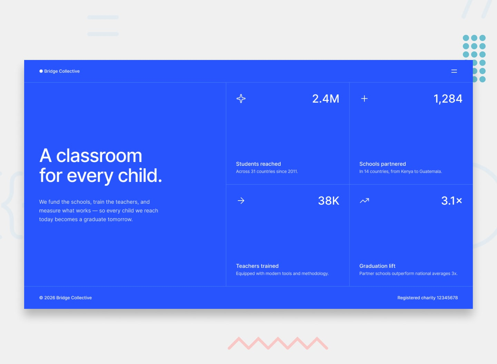

# Frontend Mentor - Grid landing page solution

This is a solution to the [Grid landing page challenge on Frontend Mentor](https://www.frontendmentor.io/challenges/grid-landing-page).
Frontend Mentor challenges help you improve your coding skills by building realistic projects.

## Table of contents

- [Overview](#overview)
  - [The challenge](#the-challenge)
  - [Screenshot](#screenshot)
  - [Links](#links)
- [My process](#my-process)
  - [Built with](#built-with)
  - [Project structure](#project-structure)
  - [What I learned](#what-i-learned)
  - [Continued development](#continued-development)
- [Author](#author)

## Overview

### The challenge

Users should be able to:

- View the optimal layout for the page depending on their device's screen size
- See hover and focus states for all interactive elements on the page
- Open and close the navigation menu at any screen size

### Screenshot



### Links

- Solution URL: [github.com/tagrgr/grid-landing-page](https://github.com/tagrgr/grid-landing-page)
- Live Site URL: [tagrgr.github.io/grid-landing-page](https://tagrgr.github.io/grid-landing-page/)

## My process

### Built with

- Semantic HTML5 markup
- CSS custom properties, with the style guide values kept in their own `token.css`
- CSS Grid for the page layout and the 2x2 stat grid
- Flexbox for the header, footer and card internals
- Mobile-first workflow, with breakpoints at `40em` and `64em`
- Self-hosted [Inter](https://fonts.google.com/specimen/Inter) variable font — no external requests
- Vanilla JavaScript for the menu — no libraries, no build step

There is nothing to install: clone the repository and open `index.html`, or serve the
folder with any static server.

### Project structure

```
index.html
assets/
  fonts/inter/      self-hosted variable font
  images/           SVG icons and the favicon
src/
  css/
    reset.css       clears browser defaults
    token.css       the design system: colors, type scale, spacing, layout sizes
    style.css       every component, at the mobile size
    responsive.css  the two breakpoints, and nothing else
  js/
    script.js       the navigation menu
```

Splitting the stylesheets this way means a change to a design value happens in exactly one
place, and every rule that depends on viewport width lives in a single file.

### What I learned

**One grid, three arrangements.** The whole page is a single grid whose shape changes
twice. On mobile everything is one column; from `40em` the stats become a 2x2 block under
the hero; from `64em` the hero takes 45% of the width and the stat grid takes the rest:

```css
@media (min-width: 64em) {
    .layout {
        grid-template-columns: 45% 1fr;
    }
}
```

**The hairlines are borders, not gaps.** With no imagery in the design, the 1px dividers
carry the whole layout, so they have to land exactly where the grid lines are. Rather than
drawing them per card, each breakpoint states which cards need which edge — and removes
the ones a neighbouring element already draws:

```css
.stat {
    padding: var(--spacing-500);
    border-left: 1px solid var(--color-divider);
}

/* THE HEADER'S BORDER ALREADY DRAWS THE LINE ABOVE THE TOP ROW */
.stat:nth-child(-n + 2) {
    border-top: none;
}
```

**Capping the measure controls the line breaks.** The headline breaks after "classroom"
in the design, which no font size alone will produce — it comes from a `max-width` on the
text itself. Setting both the headline and the paragraph to `25rem` reproduces the
design's line breaks at every width.

**The grid cell is the list item; the link fills it.** Making the `<a>` a block that
stretches over the whole cell is what makes the entire card clickable and gives the hover
state the full card area, instead of just the text:

```css
.stats li {
    display: grid;
}
```

**`hidden` plus `aria-expanded` is the whole menu.** The panel, the overlay and the button
state are set in one function, so they cannot drift apart:

```js
function setMenu(open) {
    toggle.setAttribute('aria-expanded', String(open));
    menu.hidden = !open;
    overlay.hidden = !open;
}
```

The icon swap then needs no JavaScript at all — it is pure CSS driven by the button's own
attribute:

```css
.menu-toggle[aria-expanded='true'] .icon-menu {
    display: none;
}
```

**An overlay menu needs more than one way out.** Besides the toggle, the menu closes on a
click on the overlay, on `Escape` (which also returns focus to the button), and on a click
on any of its links — the links are placeholders, so nothing else would signal that the
menu reacted.

**Underline on hover, not a border.** A `border-bottom` that only appears on hover shifts
every link by a pixel; `text-decoration` with `text-underline-offset` draws the same line
without touching the layout.

**Accessibility details that are easy to skip.** The icons are decorative, so they carry
`alt=""`, and the icon-only button gets its name from a visually hidden `<span>`. Focus is
styled through `:focus-visible` so it shows for keyboard users without following every
mouse click, and the card transition is disabled under `prefers-reduced-motion`.

### Continued development

- Slide the menu panel in from the edge instead of appearing instantly.
- Trap keyboard focus inside the menu while it is open.
- Count the stat numbers up from zero on load, behind a `prefers-reduced-motion` check.

## Author

- GitHub - [@tagrgr](https://github.com/tagrgr)
- Frontend Mentor - [@tagrgr](https://www.frontendmentor.io/profile/tagrgr)
